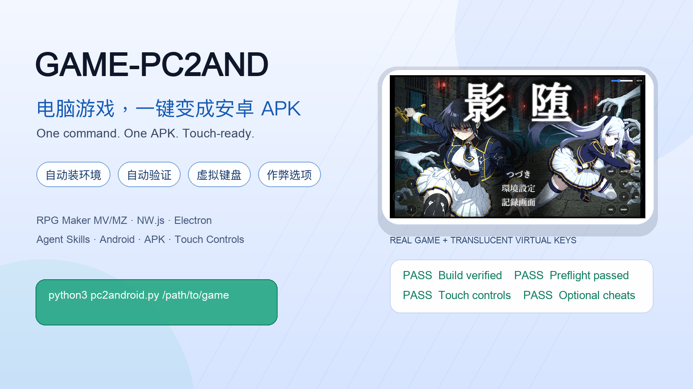
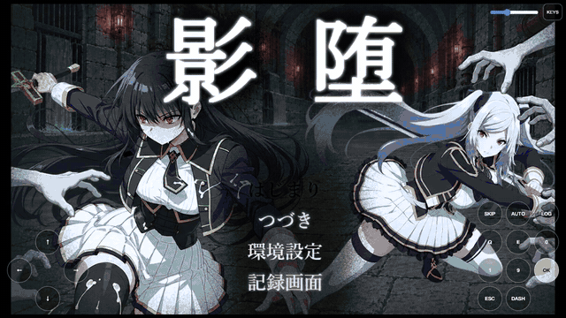

# game-pc2and

**Turn PC games into one Android APK — with one command.**  
RPG Maker MV/MZ · NW.js · Electron · automatic setup · verification · virtual keyboard · optional cheats

[](https://github.com/SpellingDragon/game-pc2and/actions/workflows/ci.yml)
[](LICENSE)

[中文](README.md) · [Latest release](https://github.com/SpellingDragon/game-pc2and/releases/latest) · [Watch the 28-second demo](https://github.com/SpellingDragon/game-pc2and/releases/latest/download/game-pc2and-demo.mp4)



## Demo



[Full demo video (real build logs, virtual keyboard, 3D camera and verification report)](https://github.com/SpellingDragon/game-pc2and/releases/latest/download/game-pc2and-demo.mp4)

The current video shows the APK running in the desktop preflight. With a USB-debug-enabled phone connected, record a device clip with:

```bash
bash docs/device-demo.sh /path/to/Game-WebView.apk
```

The script installs and launches the APK, records the screen and pulls back `device-demo.mp4`.

## Usage

### As an Agent Skill

```bash
git clone https://github.com/SpellingDragon/game-pc2and.git
cd game-pc2and
```

Copy `skills/pc2android` into your agent's user-level or project-level skills directory and reload skills, then:

```text
/pc2android /path/to/game
```

Skill directory locations vary by agent; mount the same directory according to your agent's documentation.

### Direct script

```bash
python3 skills/pc2android/scripts/pc2android.py /path/to/game
```

On the first run, missing JDK, Android SDK components, Gradle, Chrome for Testing and Python dependencies are installed automatically. Network access and a few GB of free disk space are required.

Output is written to the current directory:

```text
<game-name>-WebView.apk
<game-name>-preflight/report.json
<game-name>-preflight/title.png / map.png
```

The APK is emitted only on exit code 0. On failure, inspect `failures`, `suggestions`, `cheat.candidates` and `remediation` in `report.json`.

## Supported engines

| Engine | Status |
|---|---|
| RPG Maker MZ | verified |
| RPG Maker MV | verified |
| NW.js | verified |
| Electron (asar) | verified |
| Windows-native engines (QLIE, KiriKiri, ...) | use Winlator instead |

## Touch controls and cheats

- Menu/ADV/turn-based games keep touch input; input-rich games such as MZ3D titles get a translucent virtual keyboard with hide and opacity controls.
- Hold = keydown, release = keyup, multi-touch supported.

```bash
python3 skills/pc2android/scripts/pc2android.py /path/to/game --cheat
```

- RPG Maker: positive `price` becomes negative, `price == 0` becomes `-0`; nonzero enemy `exp` gets a leading `1`.
- Custom Electron engines exposing `window.__GAME_DATA__`: recursively patch `price` values.
- Only staged data is changed; source game files are untouched. Counts are written to `report.json` under `cheat`.

## Technology

Detect engine and entry → compatibility fixes → WebView APK → APK-served preflight → input profile and touch/virtual keyboard.

<details>
<summary>Advanced options and troubleshooting</summary>

```bash
python3 skills/pc2android/scripts/pc2android.py \
  --source /path/to/game \
  --name "Game Name" \
  --application-id com.example.game \
  --out /path/to/output \
  --preflight
```

- `--engine auto|rmmz|rmmv|nwjs|electron`
- `--dry-run` — detect and stage only
- omit `--preflight` — build and verify without the browser run
- `--browser <path>` — explicit Chromium path
- `--keep-work` — keep the generated Android project

For download errors, check `HTTPS_PROXY` and curl, then rerun.

</details>

## FAQ

**Do I need root?** No.  
**Do I need Android Studio?** No, SDK components are installed automatically.  
**Does it support every PC game?** It currently targets HTML5, RPG Maker MV/MZ, NW.js and Electron games.  
**Are game assets included?** No. Package only games you own or are authorized to distribute.  
**Does the virtual keyboard play for me?** No, it only translates touch into game key events.

## License

MIT, see [LICENSE](LICENSE). Third-party notices: [THIRD_PARTY_NOTICES.md](THIRD_PARTY_NOTICES.md).

RPG Maker is a trademark of Gotcha Gotcha Games Corporation. Android is a trademark of Google LLC. This project is not affiliated with or endorsed by them.
