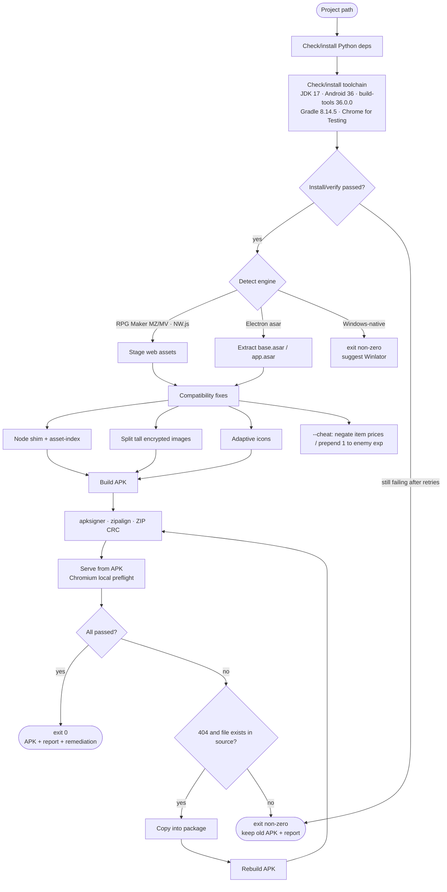

# pc2android

Package PC HTML5 / RPG Maker MV/MZ (NW.js) / Electron games into a **single Android APK**.

One command, one argument. Missing JDK, Android SDK components, Gradle, Chrome for Testing and Python dependencies are downloaded, installed and verified automatically. Build, signature/alignment/CRC verification, local preflight and missing-asset repair run as one pipeline.

[中文](README.md)

## One command

The repository ships the tool only as an Agent Skill. After mounting:

```text
/pc2android /path/to/game
```

You can also run the script inside the skill directly:

```bash
python3 skills/pc2android/scripts/pc2android.py /path/to/game
```

Optional cheat (RPG Maker data only):

```bash
python3 skills/pc2android/scripts/pc2android.py /path/to/game --cheat
```

It automatically:

- detects RPG Maker MZ/MV (NW.js) and Electron (asar) projects
- derives the app name and package id from `index.html` / `package.json`
- installs a missing toolchain into `~/.pc2android/` (`PC2ANDROID_HOME` overrides it) and verifies every component
- generates mipmaps, an Android 8+ adaptive icon and a round icon
- builds the APK, then verifies it with `apksigner`, `zipalign` and a full ZIP CRC test
- serves assets directly from the built APK and drives Chromium through CDP for the local preflight
- repairs missing assets that exist elsewhere in the source tree, rebuilds and re-runs the preflight
- **emits the APK only when everything passes**; any failure exits non-zero and never replaces an older APK

Output is written to the current directory:

```
<app-name>-WebView.apk
<app-name>-preflight/report.json
<app-name>-preflight/title.png
<app-name>-preflight/map.png
```

## Pipeline



A missing toolchain is installed and verified before the build (downloads retry three times). A failed preflight is auto-repaired only when the missing file exists in the source tree; otherwise the tool exits non-zero. Every automatic action is recorded in the `remediation` field of `report.json`.

## Use as an Agent Skill

`skills/pc2android/` follows the Agent Skills `SKILL.md` convention and can be mounted by any compatible agent. Qoder example:

```bash
git clone https://github.com/SpellingDragon/pc2android.git
cd pc2android
mkdir -p ~/.qoder/skills
cp -R skills/pc2android ~/.qoder/skills/
```

Run `/skills reload` in Qoder, then:

```text
/pc2android /path/to/game
```

Claude Code example:

```bash
mkdir -p ~/.claude/skills
cp -R skills/pc2android ~/.claude/skills/
```

In Claude Code, invoke `/pc2android /path/to/game` or trigger it with natural language.

Project-level: copy `skills/pc2android` into the project's skills directory (for example `.qoder/skills/`, `.claude/skills/`). For other agents, copy the same directory to their skill location.

## Cheat option (optional)

RPG Maker MV/MZ uses the standard data files; custom Electron engines (for example Bitter Sweets Endroll) use a dedicated adapter for `window.__GAME_DATA__`.

- `data/Items.json`: positive `price` becomes negative; `price == 0` becomes `-0`; already negative values are unchanged.
- `data/Enemies.json`: when `exp != 0`, prepend `1` to the decimal value (50→150, 5→15, 100→1100); `exp == 0` is unchanged.
- Only the staged copy is modified; the source game files are never touched. Hard links are broken with a temporary file + atomic replace. Counts are written to the `cheat` field of `report.json`.
- Custom Electron engines: recursively patch every `price` in `window.__GAME_DATA__` with the same rules; these engines usually have no enemy `exp` field.
- When no supported data is found, the script scans assets for `price / exp / gold / item / shop / enemy / 所持金 / 価格 / 経験値`, lists candidate files in the error and records them under `cheat.candidates`.
- Projects without RPG Maker data or `__GAME_DATA__` print a skip message and build normally.

## Success contract: exhaust automatic repair before failing

Exit code 0 means everything passed, but the tool does not hand solvable problems back to the user. Before declaring failure it completes this ladder:

1. **Missing toolchain**: download and install JDK 17, Android platform 36, build-tools 36.0.0, Gradle 8.14.5 and Chrome for Testing; retry downloads three times; support authenticated proxies; verify every component.
2. **Missing Python dependencies**: create `~/.pc2android/venv` and re-exec.
3. **Preflight 404**: search the source tree by the same path, encrypted variant, same filename and alternate roots (including Electron asar extractions); copy the file into the package.
4. **After repair**: rebuild the APK, re-run signing/alignment/CRC and the preflight, up to two passes.
5. **Transient network/service failures**: retry; reuse installed components.
6. **Still failing**: exit non-zero, keep `report.json`, logs and the old APK; never emit a partial or conditional success.

Every action is recorded in `report.json` under `remediation` and printed as a `Remediation (N)` list.

Final gate (all must hold for exit 0):

- Build, `apksigner`, `zipalign` and full ZIP CRC verification pass
- The preflight reaches the title/map; images are ready; no image, WebGL or JavaScript errors; fonts are ready
- Every packaged asset request is served; a packaged asset that returns 404 is a failure
- Save → load → remove round-trip succeeds
- Electron mode finishes startup, has the correct stage scale and passes a localStorage round-trip

The only tolerated case: a requested file does not exist anywhere in the source game (the game's own optional probe). This is not a packaging defect — the file was never in the package. If it exists elsewhere in the source tree, the tool copies it into the package and rebuilds.

## Automatic installation

Missing components are installed into `~/.pc2android/` and verified:

| Component | Version | Source / check |
|---|---|---|
| JDK | Temurin 17 | Adoptium API, `java -version` ≥ 17 |
| Android platform | 36 | Google repository XML, SHA-1 verified |
| build-tools | 36.0.0 | Same, `aapt2` executable |
| Gradle | 8.14.5 | services.gradle.org, `gradle --version` |
| Chrome for Testing | 133.0.6943.141 | Chrome for Testing, executable |
| Python deps | Pillow, websocket-client | `~/.pc2android/venv` |

Downloads use the system `curl` and honor `HTTPS_PROXY` / `HTTP_PROXY`, including authenticated proxies. Installation is idempotent.

## Supported engines

| Engine | Status |
|---|---|
| RPG Maker MZ | verified |
| RPG Maker MV | verified |
| NW.js | verified |
| Electron (base.asar + app.asar) | verified (one player adapter) |
| Windows-native engines (QLIE, KiriKiri, ...) | not supported; use Winlator |

## How it works

1. **Engine detection and safe staging** — copies only the web runtime; large media is hard-linked, the `js/` tree is copied so plugin rewrites never touch the source game.
2. **Node shim and `asset-index.json`** — provides `require('fs')` for NW.js-oriented plugins; `fs.accessSync` answers from a generated asset index instead of spawning thousands of probes.
3. **Encrypted long-image splitting** — encrypted PNGs referenced by `plugins.js` taller than 2048 px are split, re-encrypted and the plugin parameters rewritten.
4. **Adaptive icons** — picks the largest source icon, generates mipmaps, `anydpi-v26` adaptive icons and round icons with a dominant-color background.
5. **APK-served preflight** — serves assets straight from the APK zip entries (Range/HEAD, keep-alive, encrypted-suffix MIME) and drives Chromium via CDP.
6. **Repair loop** — a 404 triggers a source-tree search (same path, encrypted variant, same filename), copies the file into the staged assets, rebuilds and re-runs the preflight, up to two passes.
7. **Determinism and atomic artifacts** — identical input produces an identical APK hash; the final APK is replaced only after verification and preflight pass.

## Advanced usage

The one-command mode is the default. For full control:

```bash
python3 skills/pc2android/scripts/pc2android.py \
  --source /path/to/game \
  --name "Game Name" \
  --application-id com.example.game \
  --out /path/to/output \
  --preflight
```

- `--engine auto|rmmz|rmmv|nwjs|electron`
- `--dry-run` — detect and stage only
- omit `--preflight` — build and verify without the browser run
- `--browser` — explicit Chromium/Chrome path
- `--cheat` — enable the RPG Maker cheat (negative item prices, prepended enemy exp)
- `--keep-work` — keep the generated Android project

## Known limitations

- The preflight runs desktop Chromium, not Android WebView or a device GPU; real-device installation is the final acceptance.
- Electron support is one player adapter (`GameMain.html` + `base.asar`); other Electron shells may need adjustment.
- On Windows, use WSL (downloads and paths are POSIX-oriented).
- Icon sharpness is limited by the source icon (for example a 128 px icon).
- APKs close to 3 GB depend on device storage and installer speed.
- No game content is included and no DRM is bypassed; only package games you own or are authorized to distribute.

## License

MIT, see [LICENSE](LICENSE). Third-party notices: [THIRD_PARTY_NOTICES.md](THIRD_PARTY_NOTICES.md).

RPG Maker is a trademark of Gotcha Gotcha Games Corporation. Android is a trademark of Google LLC. This project is not affiliated with or endorsed by them.
