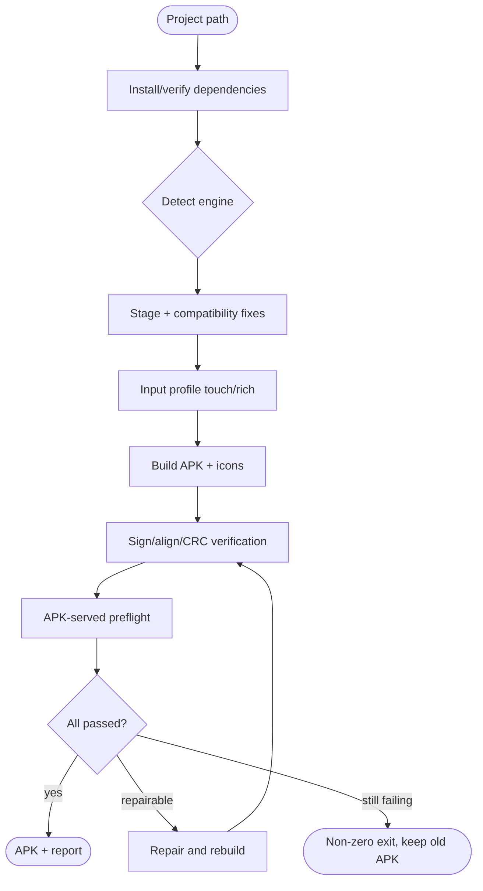

# game-pc2and

**Turn PC games into one Android APK — with one command.**  
PC-to-Android packaging for RPG Maker MV/MZ, NW.js and Electron games: automatic dependency setup, build verification, touch controls, an optional translucent virtual keyboard and optional cheats.

[](https://github.com/SpellingDragon/game-pc2and/actions/workflows/ci.yml)
[](LICENSE)

[中文](README.md) · [Latest release](https://github.com/SpellingDragon/game-pc2and/releases/latest) · [Watch the 28-second demo](https://github.com/SpellingDragon/game-pc2and/releases/latest/download/game-pc2and-demo.mp4)


## See it in 30 seconds


[Watch the full demo video (real build logs, virtual keyboard, 3D camera and verification report)](https://github.com/SpellingDragon/game-pc2and/releases/latest/download/game-pc2and-demo.mp4)

## One command

### Option 1: use it as an Agent Skill

```bash
git clone https://github.com/SpellingDragon/game-pc2and.git
cd game-pc2and
mkdir -p ~/.qoder/skills
cp -R skills/pc2android ~/.qoder/skills/
```

Reload skills in Qoder, then:

```text
/pc2android /path/to/game
```

For Claude Code, copy `skills/pc2android` to `~/.claude/skills/`. Other Agent Skills-compatible agents can mount the same directory according to their documentation.

### Option 2: run the script directly

```bash
python3 skills/pc2android/scripts/pc2android.py /path/to/game
```

On the first run, missing JDK, Android SDK components, Gradle, Chrome for Testing and Python dependencies are downloaded, installed and verified automatically. You need network access and a few GB of free disk space.

## What you get

- **One self-contained APK** — no OBB, no manual extraction.
- **A playable touch build** — menu/ADV games stay touch-friendly; MZ3D and other input-rich games get a translucent virtual keyboard.
- **A verification report** — startup, title/map, images, WebGL, fonts and save/load round-trip.
- **Optional cheats** — negative item prices, `-0` for zero prices, prepended enemy EXP, plus a custom Electron price adapter.

Output is written to the current directory:

```text
<game-name>-WebView.apk
<game-name>-preflight/report.json
<game-name>-preflight/title.png / map.png
```

## Why it is beginner-friendly

| You do not have to solve | The tool handles it |
|---|---|
| Installing JDK, SDK, Gradle and Chrome | Downloads, installs and verifies missing tools |
| Detecting the engine and entry point | RPG Maker MZ/MV, NW.js and Electron detection |
| Encrypted assets and plugin compatibility | Automatic compatibility fixes |
| Playing keyboard-heavy games on a phone | A translucent virtual keyboard for rich-input games |
| Knowing whether the APK really boots | Chromium preflight served directly from the APK |
| Finding cheatable data | Keyword scan with candidate files in the error report |

## Screenshots

### Translucent virtual keyboard

Hold = keydown, release = keyup, multi-touch, hide toggle and opacity control.


### Real verification report


## Supported games

| Engine | Status |
|---|---|
| RPG Maker MZ | verified |
| RPG Maker MV | verified |
| NW.js | verified |
| Electron (asar) | verified |
| Windows-native engines (QLIE, KiriKiri, ...) | use Winlator instead |

## How it works, briefly

1. Detect the engine and stage the web runtime.
2. Apply compatibility fixes for Node APIs, keyboard mappings and encrypted images.
3. Build a single Android WebView APK with adaptive launcher icons.
4. Serve assets directly from the APK and run a Chromium preflight.
5. Analyze input needs and add touch controls or a virtual keyboard.

<details>
<summary>Pipeline diagram</summary>



</details>

## Success means success

Exit code 0 means build, signing, alignment, CRC, images, WebGL, fonts, packaged-asset serving and save/load verification all passed. The tool automatically installs dependencies and repairs missing assets before failing; it never leaves a partial or conditional success.

## Optional cheats

```bash
python3 skills/pc2android/scripts/pc2android.py /path/to/game --cheat
```

- RPG Maker: positive `price` becomes negative, `price == 0` becomes `-0`; nonzero enemy `exp` gets a leading `1`.
- Custom Electron engines such as Bitter Sweets Endroll: recursively patch `price` in `window.__GAME_DATA__`.
- Only staged data is changed; source game files are untouched. Counts are written to `report.json` under `cheat`.

<details>
<summary>Advanced options and troubleshooting</summary>

```bash
python3 skills/pc2android/scripts/pc2android.py \
  --source /path/to/game \
  --name "Game Name" \
  --application-id com.example.game \
  --out /path/to/output \
  --preflight
```

- `--engine auto|rmmz|rmmv|nwjs|electron`
- `--dry-run` — detect and stage only
- omit `--preflight` — build and verify without the browser run
- `--browser <path>` — explicit Chromium path
- `--keep-work` — keep the generated Android project

For failures, inspect `failures`, `cheat.candidates`, `suggestions` and `remediation` in `report.json`. For download errors, check `HTTPS_PROXY` and curl, then rerun.

</details>

## FAQ

**Do I need root?** No.  
**Do I need Android Studio?** No, SDK components are installed automatically.  
**Does it support every PC game?** No, it currently targets HTML5, RPG Maker MV/MZ, NW.js and Electron games.  
**Are game assets included?** No. The repository contains only the tool and documentation; package only games you own or are authorized to distribute.  
**Does the virtual keyboard play for me?** No, it only translates touch into game key events.

## License

MIT, see [LICENSE](LICENSE). Third-party notices: [THIRD_PARTY_NOTICES.md](THIRD_PARTY_NOTICES.md).

RPG Maker is a trademark of Gotcha Gotcha Games Corporation. Android is a trademark of Google LLC. This project is not affiliated with or endorsed by them.
