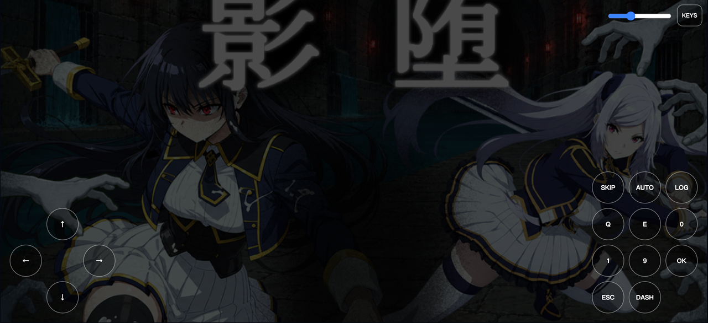
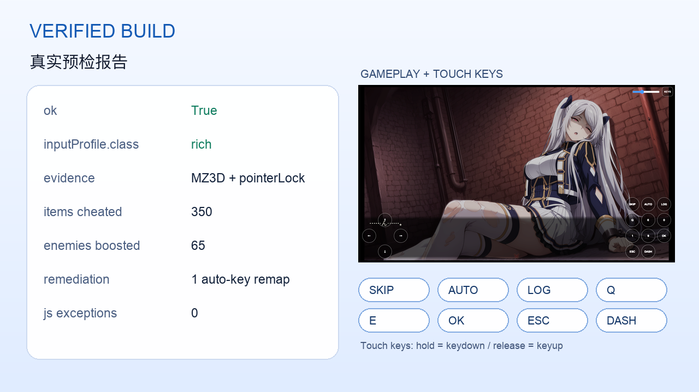
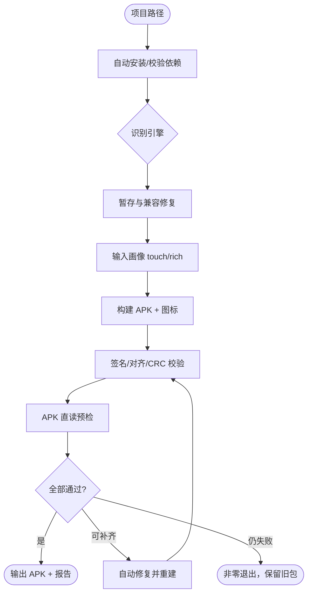

# game-pc2and

**电脑游戏，一键变成安卓 APK。**  
PC 游戏转 Android、RPG Maker MV/MZ 转 APK、NW.js / Electron 移植，都不用手动配环境：自动安装依赖、自动打包、自动验证，还能按游戏需求加半透明虚拟键盘与可选作弊。

[](https://github.com/SpellingDragon/game-pc2and/actions/workflows/ci.yml)
[](LICENSE)

[English](README.en.md) · [下载最新版](https://github.com/SpellingDragon/game-pc2and/releases/latest) · [观看 28 秒演示](https://github.com/SpellingDragon/game-pc2and/releases/latest/download/game-pc2and-demo.mp4)


## 30 秒看懂


[点击观看完整演示视频（MP4，含真实构建日志、虚拟键盘、3D 镜头与预检报告）](https://github.com/SpellingDragon/game-pc2and/releases/latest/download/game-pc2and-demo.mp4)

## 你只需要一行命令

### 方式一：作为 Agent Skill 使用（推荐）

把仓库里的 `skills/pc2android` 挂载到你的 Agent：

```bash
git clone https://github.com/SpellingDragon/game-pc2and.git
cd game-pc2and
```

把 `skills/pc2android` 复制到你的 Agent 的用户级或项目级 skills 目录，重新加载 skills 后：

```text
/pc2android /path/to/game
```

不同 Agent 的 skills 目录位置不同，按其文档挂载同一目录即可。

### 方式二：直接运行脚本

```bash
python3 skills/pc2android/scripts/pc2android.py /path/to/game
```

**第一次运行会联网自动安装缺失的 JDK、Android SDK 组件、Gradle、Chrome for Testing 和 Python 依赖**，请准备几 GB 磁盘空间。之后每次打包就是这一条命令。

## 你会得到什么

- 一个**单 APK**：游戏资源全部内置，不需要 OBB、不需要再解压。
- 一个**可安装、可触屏玩的版本**：菜单/ADV 游戏自动保持触屏操作；MZ3D 等复杂输入游戏自动加半透明虚拟键盘。
- 一份**验证报告**：启动、标题/地图、图片、WebGL、字体、存档往返都有结果。
- 可选**作弊版**：RPG Maker 物品价格变负、0 价格变 `-0`，敌人经验前加 1；苦甜终幕这类自定义引擎也有价格适配。

输出在当前目录：

```text
<游戏名>-WebView.apk
<游戏名>-preflight/report.json
<游戏名>-preflight/title.png / map.png
```

## 为什么省心

| 你不用再操心 | 工具会自动做 |
|---|---|
| JDK、SDK、Gradle、Chrome 怎么装 | 缺失就下载、安装、校验版本 |
| 游戏引擎和入口怎么判断 | 自动识别 RPG Maker MZ/MV、NW.js、Electron |
| 加密图片、插件兼容、启动报错 | 自动做兼容修复，能修就修 |
| 手机上没有键盘怎么办 | rich 输入游戏自动加半透明虚拟键盘 |
| 打包完到底能不能跑 | 从 APK 直接起服务，用 Chromium 跑预检 |
| 作弊数据找不到 | 扫描 price/exp/gold 等关键字，告诉你候选文件 |

## 看看实际效果

### 半透明虚拟键盘

方向、OK/ESC/DASH、SKIP/AUTO/LOG、Q/E 镜头等按键按游戏自动生成；按住即按下、松开即释放，支持多指，能隐藏、能调透明度。



### 真实预检报告



## 支持哪些游戏

| 类型 | 状态 |
|---|---|
| RPG Maker MZ | 已验证 |
| RPG Maker MV | 已验证 |
| NW.js 网页游戏 | 已验证 |
| Electron（asar） | 已验证 |
| Windows 原生引擎（QLIE、KiriKiri 等） | 不适用，建议 Winlator |

## 技术简述（不用懂也能用）

1. **识别与暂存**：找到游戏入口，只拷贝网页运行需要的资源。
2. **兼容修复**：补 Node 环境、键盘映射、加密长图分片等常见问题。
3. **打成单 APK**：用 Android WebView 从本地资产加载游戏，生成自适应图标。
4. **自动验证**：直接从打好的 APK 服务资源，用 Chromium 跑启动、地图和存档。
5. **触屏适配**：分析输入需求；简单游戏保持触屏，复杂游戏注入虚拟键盘。

<details>
<summary>展开技术流程图</summary>



</details>

## 成功才算成功

退出码 0 表示构建、签名、对齐、CRC、图片、WebGL、字体、已打包资源服务、存档往返全部通过。失败前会自动装依赖、自动找缺失资源并重建；仍不行才非零退出，**不会留下一个“看起来成功”的半成品**。

## 可选作弊

```bash
python3 skills/pc2android/scripts/pc2android.py /path/to/game --cheat
```

- RPG Maker：物品 `price > 0` 取负，`price == 0` 变 `-0`；敌人 `exp != 0` 时最高位前加 `1`。
- 苦甜终幕等自定义 Electron：递归修改 `window.__GAME_DATA__` 里的 `price`。
- 只改暂存副本，源游戏文件不动；数量写入 `report.json` 的 `cheat` 字段。

<details>
<summary>高级参数与故障排查</summary>

```bash
python3 skills/pc2android/scripts/pc2android.py \
  --source /path/to/game \
  --name "Game Name" \
  --application-id com.example.game \
  --out /path/to/output \
  --preflight
```

- `--engine auto|rmmz|rmmv|nwjs|electron`
- `--dry-run`：只检测与暂存
- 省略 `--preflight`：只构建并校验
- `--browser <path>`：指定 Chromium
- `--keep-work`：保留生成的 Android 工程

失败时看 `report.json` 的 `failures`、`cheat.candidates`、`suggestions` 与 `remediation`；下载失败检查 `HTTPS_PROXY` 与 curl 后重跑。

</details>

## 常见问题

**需要 root 吗？** 不需要。  
**需要 Android Studio 吗？** 不需要，SDK 组件会自动安装。  
**所有 PC 游戏都能转吗？** 不是，当前面向 HTML5 / RPG Maker MV/MZ / NW.js / Electron。  
**游戏资源会进仓库吗？** 不会。仓库只有工具和文档；请只打包你拥有或已获授权的游戏。  
**虚拟键盘会自动代打吗？** 不会，它只是把触摸转成游戏按键。

## License

MIT，见 [LICENSE](LICENSE)。第三方致谢见 [THIRD_PARTY_NOTICES.md](THIRD_PARTY_NOTICES.md)。

RPG Maker 是 Gotcha Gotcha Games 的商标；Android 是 Google LLC 的商标。本项目与上述组织无关联。
