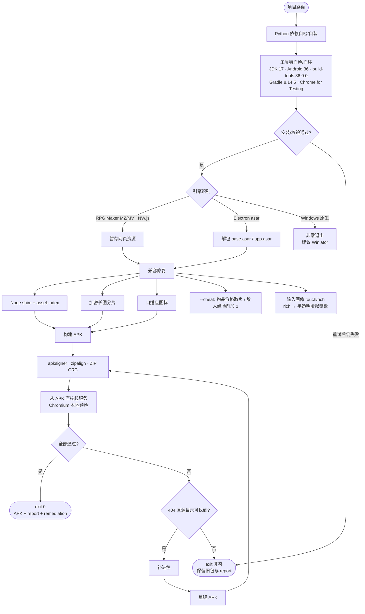

# pc2android

把 PC 上的 HTML5 / RPG Maker MV/MZ（NW.js）/ Electron 游戏打包成**单个 Android APK**。

一行命令、一个参数。缺失的 JDK、Android SDK 组件、Gradle、Chrome for Testing 与 Python 依赖会自动下载安装并逐项校验；构建、签名/对齐/CRC 校验、本地预检、缺失资源自动修复全部串行完成。

[English](README.en.md)

## 一行命令

仓库只以 Agent Skill 形式提供脚本。挂载后：

```text
/pc2android /path/to/game
```

也可以直接运行 skill 内脚本：

```bash
python3 skills/pc2android/scripts/pc2android.py /path/to/game
```

可选作弊（仅 RPG Maker 数据）：

```bash
python3 skills/pc2android/scripts/pc2android.py /path/to/game --cheat
```

它会自动完成：

- 识别引擎：RPG Maker MZ / MV（NW.js）、Electron（asar）
- 从 `index.html` 标题或 `package.json` 推导应用名与包名；包名不合法时使用稳定哈希
- 安装缺失工具链到 `~/.pc2android/`（可用 `PC2ANDROID_HOME` 覆盖），安装后验证版本
- 生成五档 mipmap + Android 8+ 自适应图标 + 圆形图标
- 构建 APK → `apksigner` / `zipalign` / 全包 CRC 校验
- 直接从打好的 APK 启动本地服务，用 Chromium 跑到标题/地图并验证存档
- 预检发现“可补齐的缺失资源”时，自动从源目录其他位置找回、重建、再预检
- **全部通过才输出 APK**；任何一步失败都非零退出，且不覆盖旧包

输出到当前目录：

```
<应用名>-WebView.apk
<应用名>-preflight/report.json
<应用名>-preflight/title.png
<应用名>-preflight/map.png
```

## 流程



工具链缺失会在构建前自动安装并校验（下载失败重试 3 次）；预检失败只有在源目录能找到文件时才自动修复，其他情况非零退出。所有自动动作记录在 `report.json` 的 `remediation` 字段。

## 作为 Agent Skill 挂载

`skills/pc2android/` 遵循 Agent Skills 的 `SKILL.md` 约定，可挂载到任何兼容的 Agent。以 Qoder 为例：

```bash
git clone https://github.com/SpellingDragon/pc2android.git
cd pc2android
mkdir -p ~/.qoder/skills
cp -R skills/pc2android ~/.qoder/skills/
```

在 Qoder 中执行 `/skills reload`，然后：

```text
/pc2android /path/to/game
```

以 Claude Code 为例：

```bash
mkdir -p ~/.claude/skills
cp -R skills/pc2android ~/.claude/skills/
```

在 Claude Code 中可用 `/pc2android /path/to/game` 或自然语言触发。

项目级挂载：把 `skills/pc2android` 复制到项目对应的 skills 目录（例如 `.qoder/skills/`、`.claude/skills/`）。其他 Agent 按其 skill 目录约定挂载同一目录即可。

## 作弊选项（可选）

RPG Maker MV/MZ 走通用标准数据文件；自定义 Electron 引擎（如苦甜终幕）走 `window.__GAME_DATA__` 的定制适配。

- `data/Items.json`：`price > 0` 取负；`price == 0` 改为 `-0`；已是负数不变。
- `data/Enemies.json`：`exp != 0` 时在最高位前加 `1`（50→150，5→15，100→1100）；`exp == 0` 不变。
- 只改打包暂存副本，源游戏文件不动；通过临时文件 + 原子替换断开硬链接。数量写入 `report.json` 的 `cheat` 字段。
- 自定义 Electron 引擎：递归修改 `window.__GAME_DATA__` 内所有 `price`（规则同上）；该类引擎通常没有敌人 exp 字段。
- 找不到可改数据时，脚本按 `price / exp / gold / item / shop / enemy / 所持金 / 価格 / 経験値` 等关键字扫描资产，在错误中列出候选文件，并写入报告 `cheat.candidates`。
- 非 RPG Maker 且无 `__GAME_DATA__` 的项目会提示跳过，不影响构建。

## 输入画像与虚拟键盘

打包时生成 `input-profile.json`：

- `touch`：菜单/ADV/回合制或已有触屏按钮覆盖（如监狱勇者、苦甜终幕），不叠加控件。
- `rich`：存在 MZ3D/指针锁定等连续输入，或自定义按键较多且无触屏覆盖（如影堕），APK 注入半透明虚拟键盘。

若 MZ3D 与 MessageSkip 同时存在，打包会把 MessageSkip 自动键从 A 改为 M，避免 A 被 MZ3D 的移动映射占用（写入 `remediation`）。

虚拟键盘按住=keydown、松开=keyup，支持多指；事件同时带 `key`/`code`/`keyCode`/`which`，兼容 MZ Input 与 BackLog 的 `code` 监听；顶部可隐藏、可调透明度，切后台自动释放按键。预检报告含 `inputProfile`（class/evidence/entropy/recommended_keys）。

## 成功契约：先穷尽自动修复，再判失败

退出码 0 只代表“全部通过”，但工具不会把能自动解决的问题丢给用户。判失败之前，它会按下面的顺序把能补的条件全部补齐：

1. **缺工具链**：自动下载安装 JDK 17、Android platform 36、build-tools 36.0.0、Gradle 8.14.5、Chrome for Testing；下载失败重试 3 次，支持带凭据代理；安装后逐项校验版本。
2. **缺 Python 依赖**：自动创建 `~/.pc2android/venv` 并重入执行。
3. **预检 404**：在源目录按同路径、加密变体、同名文件、备用根目录（含 Electron asar 解包树）搜索；找到就补进包。
4. **修复后**：自动重建 APK、重新签名/对齐/CRC、重新预检，最多两轮。
5. **网络/服务瞬断**：重试；已安装组件复用，不重复下载。
6. **仍失败**：非零退出，保留 `report.json`、日志与旧 APK；不输出半成品，不把“带条件的成功”当成功。

工具会把上述动作写入 `report.json` 的 `remediation` 字段，并在终端打印 `Remediation (N)` 清单，让“已经尽力”可审计。

最终门槛（全部满足才 exit 0）：

- APK 构建、`apksigner`、`zipalign`、全包 CRC 通过
- 预检到达标题/地图；图片就绪；无图片错误、WebGL 错误、JS 异常；字体就绪
- 所有已打包资源请求都被服务；已打包却 404 即失败
- 存档写入 → 读回 → 删除往返成功
- Electron 模式启动完成、舞台缩放正确、localStorage 往返成功

唯一不判失败：请求的文件在源游戏目录中本来就不存在（游戏自身的可选探测）。这不是放过打包缺陷——它本来就不在包里；若它其实在源目录其他位置，工具会自动补进包并重建。

## 自动安装

首次运行会把缺失项安装到 `~/.pc2android/`，并逐项验证：

| 组件 | 版本 | 来源 / 校验 |
|---|---|---|
| JDK | Temurin 17 | Adoptium API，`java -version` ≥ 17 |
| Android platform | 36 | Google 仓库 XML 直链，SHA-1 校验 |
| build-tools | 36.0.0 | 同上，`aapt2` 可执行 |
| Gradle | 8.14.5 | services.gradle.org，`gradle --version` |
| Chrome for Testing | 133.0.6943.141 | Chrome for Testing，可执行 |
| Python 依赖 | Pillow、websocket-client | `~/.pc2android/venv` |

下载统一走系统 `curl`，自动使用 `HTTPS_PROXY` / `HTTP_PROXY`（含带凭据的代理）；Gradle 代理由同一环境变量注入。安装是幂等的：已存在且版本正确的组件会直接复用。

## 支持范围

| 引擎 | 状态 |
|---|---|
| RPG Maker MZ | 已验证 |
| RPG Maker MV | 已验证 |
| NW.js | 已验证 |
| Electron（base.asar + app.asar） | 已验证（一种播放器适配） |
| Windows 原生引擎（QLIE / KiriKiri 等） | 不支持，建议 Winlator |

## 工作原理

1. **引擎识别与安全暂存**：只拷贝网页运行所需目录；大媒体用硬链接，`js/` 树真实拷贝，避免改写插件时污染源游戏。
2. **Node shim 与 `asset-index.json`**：为面向 NW.js 的插件提供 `require('fs')` 等 shim；`fs.accessSync` 按打包时生成的资产清单精确回答文件/目录是否存在，避免语言探测产生数千个请求。
3. **加密长图分片**：`plugins.js` 引用的加密 PNG 高度超过 2048 时自动切片、重新加密并改写插件参数。
4. **自适应图标**：自动选最大源图，生成 mipmap、`anydpi-v26` 自适应图标、圆形图标，背景取图内主色。
5. **APK 直读预检**：预检服务器直接从 APK 的 zip 条目服务资源（支持 Range/HEAD、keep-alive、加密后缀 MIME），用 CDP 驱动 Chromium。
6. **自动修复闭环**：预检 404 → 在源目录按同路径、加密变体、同名文件搜索 → 补进暂存资产 → 重建 → 再预检，最多两轮。
7. **确定性与原子产物**：同一输入重复构建哈希一致；先写临时文件，校验与预检全过才替换正式 APK。

## 高级用法

一行命令是默认模式；需要控制细节时可用完整参数：

```bash
python3 skills/pc2android/scripts/pc2android.py \
  --source /path/to/game \
  --name "Game Name" \
  --application-id com.example.game \
  --out /path/to/output \
  --preflight
```

- `--engine auto|rmmz|rmmv|nwjs|electron`：跳过自动识别
- `--dry-run`：只检测与暂存，不构建
- 省略 `--preflight`：只构建并校验，不做浏览器预检
- `--browser`：指定 Chromium/Chrome 路径
- `--cheat`：启用 RPG Maker 作弊（物品价格取负、敌人经验前加 1）
- `--keep-work`：保留生成的 Android 工程

## 已知限制

- 预检运行在**桌面 Chromium**，不是 Android WebView / 真机 GPU；真机安装是最终验收。
- Electron 支持目前是一种播放器适配（`GameMain.html` + `base.asar`），其他 Electron 壳可能需要调整。
- Windows 建议在 WSL 中运行（下载与路径以 POSIX 为主）。
- 图标清晰度受源图限制（例如源图只有 128px）。
- 接近 3GB 的 APK 安装耗时与空间取决于设备。
- 本工具不包含任何游戏内容，也不绕过 DRM；只打包你拥有或已获授权的游戏。

## 许可

MIT，见 [LICENSE](LICENSE)。第三方致谢见 [THIRD_PARTY_NOTICES.md](THIRD_PARTY_NOTICES.md)。

RPG Maker 是 Gotcha Gotcha Games 的商标；Android 是 Google LLC 的商标。本项目与上述组织无关联。
