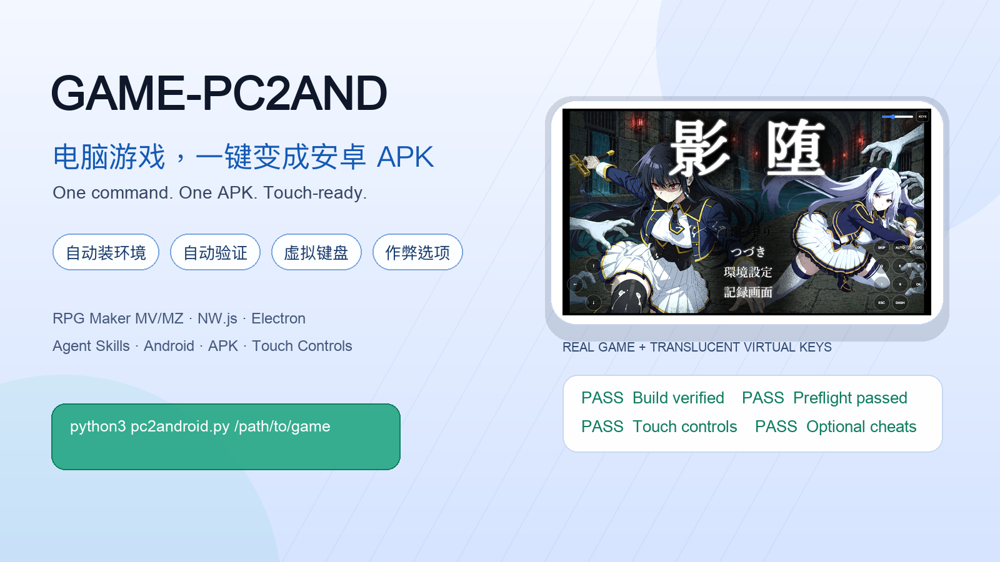
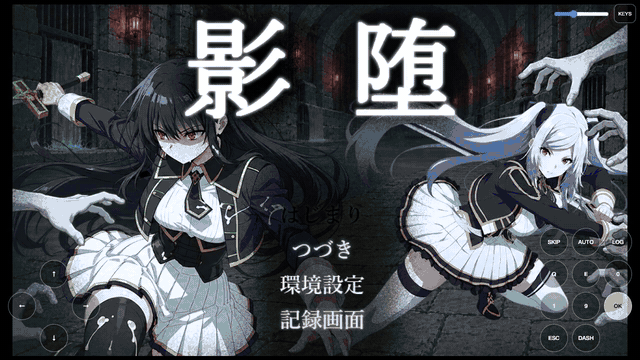

# game-pc2and

**把 PC 游戏一键打包成单个安卓 APK。**

RPG Maker MV/MZ · NW.js · Electron · KiriKiri · Siglus · RealLive · QLIE

[](https://github.com/SpellingDragon/game-pc2and/actions/workflows/ci.yml)
[](https://github.com/SpellingDragon/game-pc2and/releases/latest)
[](LICENSE)

[English](README.en.md) · [下载最新版](https://github.com/SpellingDragon/game-pc2and/releases/latest) · [观看演示](https://github.com/SpellingDragon/game-pc2and/releases/latest/download/game-pc2and-demo.mp4) · [CrySirror QLIE 补丁 PR](https://github.com/xmoezzz/CrySirror/pull/21)



## 快速开始

```bash
python3 skills/pc2android/scripts/pc2android.py /path/to/game
```

自动识别引擎，输出单个 APK。首次运行自动准备 JDK、Android SDK、Gradle；CrySirror 路径另准备 Rust 1.95、NDK、cargo-ndk。无需 Android Studio，无需 root。

## 支持什么

| 后端 | 适用 | 状态 |
|---|---|---|
| WebView | RPG Maker MZ/MV、NW.js、Electron | 已验证 |
| CrySirror | KiriKiri、Siglus、RealLive、QLIE 等 VN 引擎 | 按引擎验证 |
| — | 其他 Win32 原生引擎 | 建议 Winlator |

<details>
<summary>CrySirror 完整引擎列表</summary>

KiriKiri、Siglus、RealLive、AVG32、BGI、SoftPAL、RFVP、NScripter、Circus、CatSystem2、QLIE、Majiro、AliceSoft System 4、System-NNN、SugarPot、codeX RScript、N-System、N2System、Malie、WillPlus/AdvHD、CMVS/CVNS、ExHibit、minori、CM3D2/COM3D2、AmanatsuLocation。

</details>

识别不到时用 `--engine crysirror` 显式指定。

## 能力

- **单 APK**：游戏、运行时、虚拟键盘/宿主、许可证。
- **自动环境**：JDK、Android SDK、Gradle、Chrome、Python 依赖。
- **两条后端**：WebView（RPG Maker/NW.js/Electron）与 CrySirror（VN）。
- **虚拟键盘**：MZ3D 等连续输入，支持隐藏、透明度、多指。
- **可选作弊**：RPG Maker 物品价格、敌人经验；Electron `__GAME_DATA__`。
- **校验**：签名、对齐、CRC、资源完整性；WebView 预检。

## 演示



[完整演示视频（构建、虚拟键盘、游玩、预检）](https://github.com/SpellingDragon/game-pc2and/releases/latest/download/game-pc2and-demo.mp4)

<details>
<summary>实机录制</summary>

```bash
bash docs/device-demo.sh /path/to/Game-WebView.apk
```

</details>

## 用法

直接运行：

```bash
python3 skills/pc2android/scripts/pc2android.py /path/to/game
```

作为 Agent Skill：把 `skills/pc2android` 复制到 Agent skills 目录，然后：

```text
/pc2android /path/to/game
```

<details>
<summary>高级参数</summary>

```bash
python3 skills/pc2android/scripts/pc2android.py \
  --source /path/to/game \
  --name "Game Name" \
  --application-id com.example.game \
  --out /path/to/output \
  --preflight
```

`--engine auto|rmmz|rmmv|nwjs|electron|crysirror`、`--dry-run`、`--keep-work`、`--browser`。

</details>

## CrySirror 后端

- 自动识别 CrySirror 支持的 VN 引擎，与 WebView 并列维护。
- 只消费 `libcrysirror_mobile.so`；Android 宿主由 game-pc2and 维护，不修改上游 `platform/android`。
- APK 内含 MPL-2.0、源码 commit/修改说明、依赖许可证清单和可获取的许可证文本。
- 不走 Chromium 预检，需实机验证。

## 触屏与作弊

- 菜单/ADV/回合制保持触屏；MZ3D 自动虚拟键盘。
- `--cheat`：RPG Maker 物品 `price > 0` 取负、`price == 0` 变 `-0`、敌人 `exp != 0` 最高位前加 1；Electron `window.__GAME_DATA__` 递归修改。

## FAQ

**RPG Maker MV/MZ 能转安卓吗？** 能，直接打包 `www/` 或 `data_Win/`。

**Electron/NW.js 能打包 APK 吗？** 能，支持 `app.asar`/`base.asar` 和 `package.json` + `index.html`。

**KiriKiri/Siglus/RealLive/QLIE 能运行吗？** 走 CrySirror，按引擎/游戏验证。

**需要 Android Studio/root 吗？** 不需要。

**所有 PC 游戏都能转吗？** 不能；未列出的 Win32 引擎建议 Winlator。

**APK 是 release 签名吗？** 当前 debug 签名，正式分发请配置 release。

**游戏资源会进仓库吗？** 不会；只打包你拥有/授权的游戏。

## License

MIT。CrySirror 为 MPL-2.0；源码 commit、修改说明、依赖许可证清单和可获取的许可证文本随 APK 放在 `assets/licenses/`。
