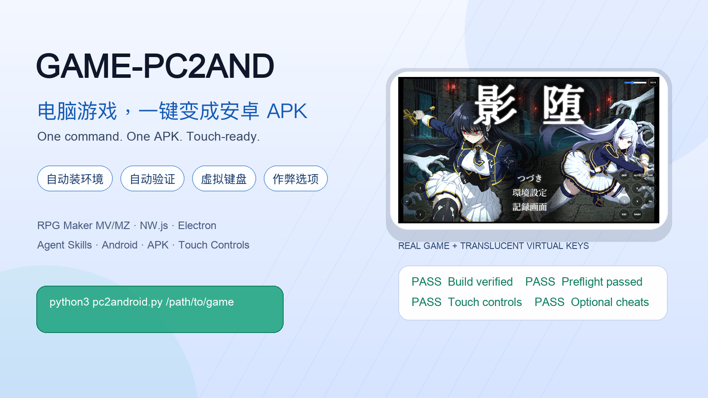
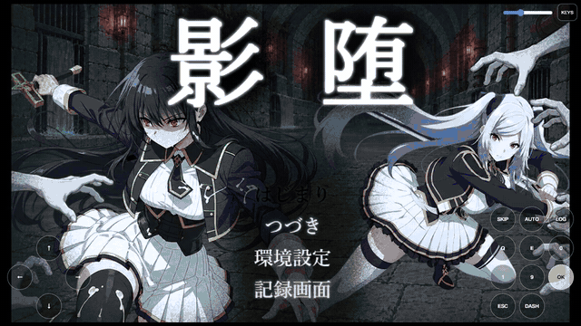
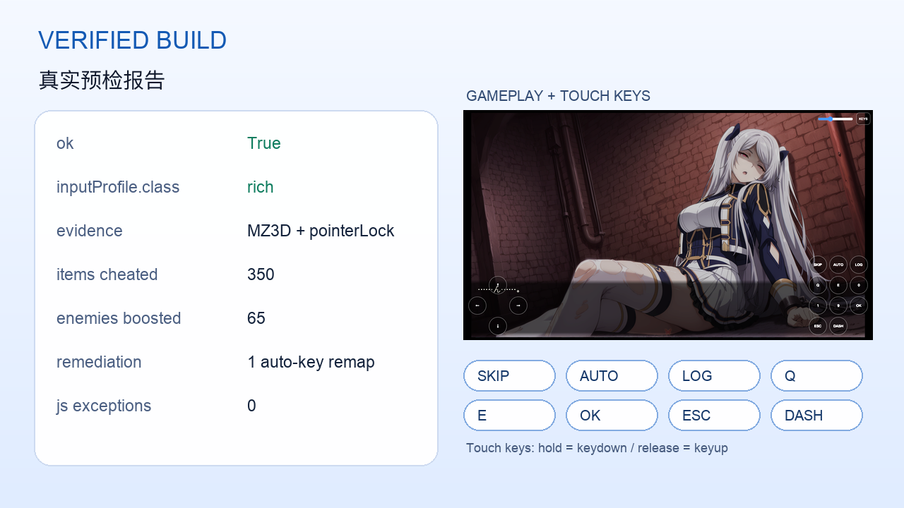

# game-pc2and：PC 游戏转安卓 APK 工具

一条命令把 RPG Maker MV/MZ、NW.js、Electron、Godot 或 CrySirror 支持的视觉小说打成可安装的单个安卓 APK。命令行自动识别引擎、准备对应后端工具链、适配触屏输入并校验安装包，无需 Android Studio 或 root。

[](https://github.com/SpellingDragon/game-pc2and/actions/workflows/ci.yml)
[](https://github.com/SpellingDragon/game-pc2and/releases/latest)
[](LICENSE)

[English](README.md) · [下载最新版](https://github.com/SpellingDragon/game-pc2and/releases/latest) · [演示视频](https://github.com/SpellingDragon/game-pc2and/releases/latest/download/game-pc2and-demo.mp4) · [完整命令行文档](skills/pc2android/SKILL.md)



## 快速开始

在 macOS 或 Linux 上准备 Python 3、Git、curl，并在首次运行时保持网络可用。CrySirror 构建还需要 rustup 和 Rust 1.95+：

```bash
git clone https://github.com/SpellingDragon/game-pc2and.git
cd game-pc2and
python3 skills/pc2android/scripts/pc2android.py /path/to/game
```

可传游戏根目录、`www/`、`data_Win/`、Godot 可执行文件或 PCK，也可传包含它们的目录。下载的工具缓存在 `~/.pc2android/`，可用 `PC2ANDROID_HOME` 改位置；成功时输出 `APK=` 与 `SHA256=`，任一项校验失败都会返回非零退出码，不把未检查的安装包当成交付物。

## 引擎支持与输出

| PC 游戏来源 | 后端 | 输出 |
|---|---|---|
| RPG Maker MV/MZ、NW.js、Electron | WebView | `<name>-WebView.apk` |
| KiriKiri、Siglus、RealLive、QLIE 等受支持的 VN 引擎 | CrySirror | `<name>-CrySirror.apk` |
| Godot 4 GDScript + GL Compatibility | Godot 恢复导出 | `<name>-Godot.apk` 和恢复报告 |
| 未列出的 Win32 原生引擎 | 无 | 使用 Winlator 等 Windows 兼容层；本工具不模拟任意 Windows 二进制 |

<details>
<summary>CrySirror 支持的引擎</summary>

KiriKiri、Siglus、RealLive、AVG32、BGI、SoftPAL、RFVP、NScripter、Circus、CatSystem2、QLIE、Majiro、AliceSoft System 4、System-NNN、SugarPot、codeX RScript、N-System、N2System、Malie、WillPlus/AdvHD、CMVS/CVNS、ExHibit、minori、CM3D2/COM3D2、AmanatsuLocation。仅在自动识别遗漏受支持的目录结构时使用 `--engine crysirror`。

</details>

## 演示

录像包含 APK 构建、按键自动重映射、多指触控游玩和预检报告。

[](https://github.com/SpellingDragon/game-pc2and/releases/latest/download/game-pc2and-demo.mp4)

## 后端机制与限制

### WebView：RPG Maker、NW.js、Electron

该后端打包游戏资源与本地运行时，再从暂存副本启动 Chromium。已打包却缺失的资源会在源目录中查找并尽可能补回后重建，源游戏目录保持不变。

### CrySirror：视觉小说原生运行时

Android 宿主由本仓库维护，只消费 `libcrysirror_mobile.so`，不复制或修改上游 `platform/android`。APK 携带源码版本、本地修改说明、依赖清单和可获取的许可证文本。

### Godot：GDScript 工程恢复

gore 定位游戏包，GDRE Tools 恢复脚本和 imported resources，匹配版本的 Godot 编辑器再调用 Android templates 导出。C#、GDExtension、Mono、自定义构建和双精度构建会被拒绝；转换失败、未转换或不支持的恢复条目同样使构建失败。有损导入单独记录，点击式界面使用原生触控，动作游戏需要单独配置虚拟按键。

## 触屏输入与可选作弊

输入检测让菜单、ADV 和回合制游戏保持直接触控；连续输入游戏注入半透明虚拟键盘，支持多指、按下/松开事件、透明度调整和隐藏。追加 `--cheat` 会把 RPG Maker 正数物品价格取负、零价格写成 `-0`，并在非零敌人经验最高位前加 `1`；暴露 `window.__GAME_DATA__` 的 Electron 游戏会递归修改价格，所有变更只落在打包暂存副本。

## 通过校验代表什么

所有后端都要求 APK 构建、签名、zip 对齐、CRC 和各自的内容检查通过。一键流程中的 WebView 构建还会检查场景、资源、JavaScript、字体、WebGL 和存档，高级命令行用 `--preflight` 开启这些预检。CrySirror 检查原生库和资源，但仍需实机验证游玩；Godot 校验恢复、导出、原生库、资源及许可证文件。当前产物使用 debug 签名，公开分发前应配置 release 签名。



## 高级用法

```bash
python3 skills/pc2android/scripts/pc2android.py \
  --source /path/to/game \
  --name "Game Name" \
  --application-id com.example.game \
  --out /path/to/output \
  --preflight
```

用 `--engine auto|rmmz|rmmv|nwjs|electron|crysirror|godot` 选择后端，`--dry-run` 检查识别结果，`--keep-work` 保留生成工程，`--browser` 指定 Chromium。[完整命令行文档](skills/pc2android/SKILL.md)说明依赖安装、自动修复顺序、报告、作弊规则和故障处理。

要把同一流程挂到兼容 Agent Skills 约定的 Agent 中，将 `skills/pc2android` 复制到其 skills 目录，然后调用：

```text
/pc2android /path/to/game
```

录制已有 WebView APK 的实机演示：

```bash
bash docs/device-demo.sh /path/to/Game-WebView.apk
```

## 许可证与分发

命令行工具采用 MIT；CrySirror 为 MPL-2.0，gore、GDRE Tools 和 Godot 为 MIT。每个 APK 都携带声明：CrySirror 和 Godot 位于 `assets/licenses/`，WebView 位于 `assets/THIRD_PARTY_NOTICES.txt`。只打包你拥有或已获授权分发的游戏；游戏资源、APK 和存档不应提交到这个开源仓库。
